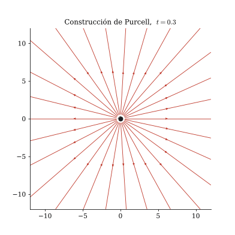
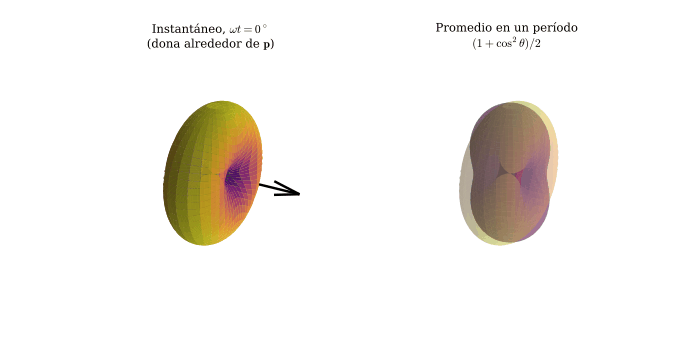
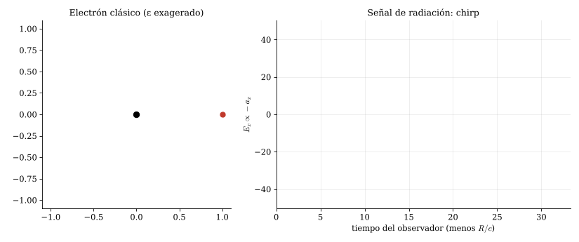

# Guía 5 — Radiación electromagnética: Liénard–Wiechert, Larmor y radiación relativista

Simulaciones de la **Guía de ejercicios N.º 5** (preparación del Quiz #5) de *Electromagnetismo Intermedio*, U. de Valparaíso, 2026. Temas: tiempo retardado, campos de velocidad y de radiación, Poynting y distribución angular, Larmor, radiación dipolar, órbitas circulares, radiación relativista y la diferencia entre el tiempo del observador y el de la fuente.

  
  

  

<em>Arriba: construcción de Purcell con campos de Liénard–Wiechert exactos (el pliegue que viaja a velocidad c es la radiación) y dipolo rotante (patrón instantáneo vs. promedio). Abajo: colapso del átomo clásico y la señal "chirp" que emitiría.</em>

## Cuadernos

| Cuaderno | Problemas | Qué se simula |
|---|---|---|
| `01_tiempo_retardado_lienard_wiechert.ipynb` | 1–3 | Diagrama espacio-tiempo de señales y $dt/dt_r=\kappa$; $E_{\rm vel}\propto R^{-2}$ vs $E_{\rm rad}\propto R^{-1}$; flujo de Poynting por esferas (rad-rad = Larmor a todo radio, el resto es energía reactiva); **construcción de Purcell** animada; $\mathbf E$, $\mathbf B$, $\mathbf S$ sobre la esfera |
| `02_larmor_dipolos.ipynb` | 4–9 | "Fotones" Monte Carlo muestreados de $\sin^2\theta$; fracción ecuatorial $11/16$; pulso gaussiano: energía $W\propto a_0^2\tau$ y **espectro**; dipolo armónico; **dipolo rotante** (animación, $(1+\cos^2\theta)/2$, doble potencia); amortiguamiento radiativo, ancho de línea clásico y vidas medias reales |
| `03_radiacion_relativista.ipynb` | 10–14 | **Colapso del átomo clásico** en $1.6\times10^{-11}$ s (animación con *chirp*); $\gamma^6$ vs $\gamma^4$; **enfriamiento sincrotrón** con reacción de radiación ($\gamma(t)=\coth$ exacto); pulsos y armónicos hasta $n\sim\gamma^3$; asimetría $\left(\frac{1+\beta}{1-\beta}\right)^3=64$; $\kappa^{-6}$ (detector) vs $\kappa^{-5}$ (fuente) con la misma energía |

## Verificaciones numéricas

| Resultado | Verificación |
|---|---|
| P1: $t_r=(t-Z/c)/(1-\beta)$ | solucionador general de $t_r$ coincide (y detecta cuándo la carga ya pasó) |
| P2: solo $E_{\rm rad}$ transporta energía al infinito | $\langle\Phi_{\rm rad\,rad}\rangle/P_{\rm Larmor}=1.0019$ para $R$ de $0.3$ a $300\,c/\omega$ (la desviación es la corrección $\mathcal O(\beta^2)$); pendiente del pliegue de Purcell $-1.01$ |
| P4: $\oint dP/d\Omega=\frac23a^2$ | integral numérica exacta a 8 cifras |
| P5: fracción $11/16$ | Monte Carlo $0.6877\pm0.0010$ |
| P6: $W=\frac23a_0^2\tau\sqrt{\pi/2}$ | exacto; pendientes $1.000$ y $2.000$; Parseval en el espectro |
| P8: dipolo rotante radia el doble | cociente $2.0000$ |
| P9: $\tau_E=1/(\omega^2\tau_q)$ | decaimiento $e^{-t/\tau_E}$ y lorentziana de ancho $\omega^2\tau_q$ |
| P10: $t_{\rm colapso}=a_0^3/(4r_e^2c)$ | EDO numérica: $1.5562\times10^{-11}$ s |
| P12: $\gamma(t)=\coth(\epsilon\Omega t+\operatorname{arccoth}\gamma_0)$ | error relativo $\sim10^{-9}$ |
| P13: razón $64$ para $\beta=0.6$ | $64.0$ |
| P14: $dt/dt_r=\kappa$; $\int R^2S\,dt=\int\frac{dP}{d\Omega}dt_r$ | error $\sim10^{-7}$; razón de energías $=1$ para todo $\beta$ |

## Ejecutar

Desde la raíz del repositorio (ver `../README.md`): activar el entorno virtual y abrir los cuadernos de esta carpeta. Cada cuaderno importa `../em_utils.py` y guarda sus figuras en `figuras/`.

## Relación con otras guías

Los Problemas 3, 7 y 11 se profundizan en la Guía 6: patrón $\sin^2\alpha$ oblicuo, dipolo de Hertz con líneas de campo, y distribución angular relativista con efecto faro (`../Guia_06_Radiacion_Covarianza/01_radiacion.ipynb`).
