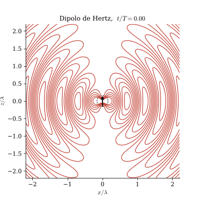
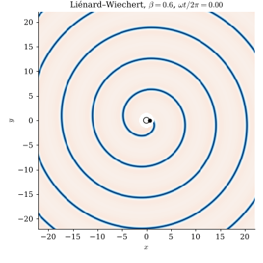
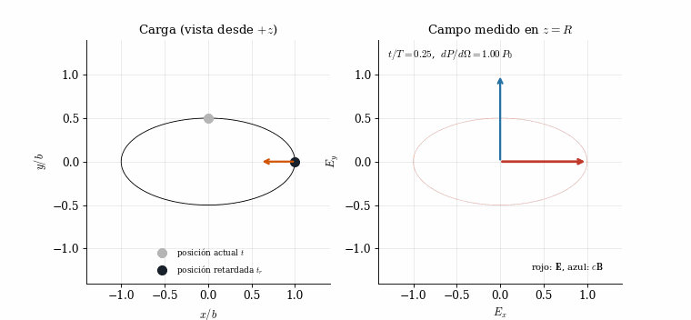

# Guía 6 — Radiación electromagnética y covarianza de la electrodinámica

Simulaciones en Python (Jupyter) que acompañan la **Guía de ejercicios N.º 6** del curso *Electromagnetismo Intermedio* (Instituto de Física y Astronomía, Universidad de Valparaíso, 2026). Temas: radiación, cuadrivectores, tensor electromagnético, ecuaciones de Maxwell, principio de acción, invariancia de gauge e invariantes de Lorentz.

El objetivo es **pedagógico**. Cada cuaderno toma un resultado que en la guía se obtiene con lápiz y papel, lo **verifica numéricamente** y después lo usa para mostrar la geometría y la física que la derivación analítica no deja ver: polarización en todas las direcciones, líneas de campo que se desprenden de un dipolo, el efecto faro, la deriva $\mathbf E\times\mathbf B$ como un boost, la ecuación de onda que emerge de una acción discreta, la espiral de Liénard–Wiechert, el plano de invariantes, etc.

  
  
  

  <em>Izquierda: líneas de E de un dipolo oscilante que se cierran y desprenden. Centro: campo de radiación de una carga en órbita circular (Liénard–Wiechert exacto, β = 0.6). Derecha: el observador ve la carga en su posición retardada; E describe una elipse (polarización elíptica).</em>

---

## Cuadernos

Cada cuaderno importa `../em_utils.py` (módulo compartido en la raíz del repositorio) y guarda sus figuras en `figuras/`.

| Cuaderno | Problema | Qué se simula | Figuras principales |
|---|---|---|---|
| **01** | 1 | Órbita elíptica: retardo, polarización en el eje y en **todas** las direcciones, $\langle dP/d\Omega\rangle=\tfrac58$ del caso circular | `P1_*` |
| | 2 | Patrón $\sin^2\alpha$ con aceleración oblicua (3D y mapa) | `P2_*` |
| | 3 | Dipolo de Hertz con campos **completos**: zonas cercana/lejana, líneas de campo como curvas de nivel de una función de flujo, ley $\omega^4$ y cielo azul | `P3_*` |
| | 4 | Liénard: distribución angular para $\mathbf a\parallel\mathbf v$ y $\mathbf a\perp\mathbf v$; integración numérica que reproduce $\gamma^6$ y $\gamma^4$; efecto faro | `P4_*` |
| **02** | 5 | Pulso de carga en el diagrama espacio-tiempo, residuo de $\partial_\mu J^\mu$, volumen de control animado, transformación al sistema propio | `P5_*` |
| | 6 | $F_{\mu\nu}$ desde los potenciales (diferencias finitas), matrices $F_{\mu\nu}$ vs $F^{\mu\nu}$, clasificación por $F_{\mu\nu}F^{\mu\nu}$ | `P6_*` |
| | 7 | $\mathbf E',\mathbf B'$ vs $\beta$; el campo de una carga en movimiento obtenido **boosteando Coulomb** punto a punto | `P7_*` |
| | 8 | Integración de $dU^\mu/d\tau=(q/m)F^{\mu\nu}U_\nu$: ciclotrón, deriva, caso crítico, fuga; **la cicloide es un círculo en el sistema de deriva** | `P8_*` |
| **03** | 9–11 | SymPy: Maxwell y Bianchi para potenciales arbitrarios; Euler–Lagrange automático | (salida simbólica) |
| | 11–12 | **Integrador variacional**: la ecuación de onda sale de $\partial S_d/\partial a^n_j=0$; antena de corriente y teorema de Poynting en la red | `P11_*` |
| | 13 | Gauge de Landau vs simétrico; $\Delta S_{\rm gauge}=0 \iff \partial_\mu J^\mu=0$; el vínculo de Gauss se rompe si la carga no se conserva | `P13_*` |
| | 14 | Cono de luz pasado, gauge de Lorenz y $\Box\phi=0$ para Liénard–Wiechert, espiral de radiación de dipolo a sincrotrón, validez de la fórmula no relativista | `P14_*` |
| **04** | 15 | Onda plana 3D, Maxwell con SymPy (por qué $\omega=ck$), Doppler y aberración, $T^{\mu\nu}\propto k^\mu k^\nu$ | `P15_*` |
| | síntesis | **Plano de invariantes**: campos de los Problemas 6, 7 y 15 bajo 400 boosts aleatorios | `Sintesis_*` |

## Verificaciones numéricas destacadas

Cada cuaderno imprime la comparación entre el resultado numérico y el analítico de la guía. Algunas:

| Resultado de la guía | Verificación |
|---|---|
| P1: $\langle dP/d\Omega\rangle_{\rm elipse}/\langle dP/d\Omega\rangle_{\rm círculo}=5/8$ | promedio temporal numérico: `0.625000` |
| P1: potencia total $\langle P\rangle=\frac{5q^2b^2\omega^4}{48\pi\varepsilon_0c^3}$ | integral sobre la esfera = $5\pi/3\,P_0$ |
| P3: $\oint\sin^2\theta\,d\Omega=8\pi/3$, $\langle P\rangle\propto\omega^4$ | pendiente log-log = `4.000` |
| P4: $P_\parallel=\gamma^6P_L$, $P_\perp=\gamma^4P_L$, $P_\parallel/P_\perp=25/16$ para $\beta=3/5$ | integración de Liénard, error $<10^{-12}$ |
| P5: $\partial_\mu J^\mu=0$, $J^\mu J_\mu$ invariante, $Q$ invariante | sistema propio: $J'^1=0$, $Q$ idéntica |
| P6: $F_{\mu\nu}F^{\mu\nu}=2(B_0^2-E_0^2/c^2)$ | `−1.2800` vs `−1.2800` |
| P7: $\mathbf E'=\gamma E_0\hat y$, $\mathbf B'=-\gamma vE_0/c^2\hat z$; Coulomb boosteado = campo de Heaviside | error relativo $\sim10^{-15}$ |
| P8: $d\mathcal E/dt=q\mathbf E\cdot\mathbf v$; $U\cdot U=c^2$; $v_d=E/B$; $T=2\pi\gamma m/qB$ | $|U\cdot U-1|\sim10^{-11}$, deriva exacta a 5 cifras |
| P9–P11: $\partial_\mu F^{\mu\nu}$ ↔ Gauss/Ampère; Bianchi; Euler–Lagrange | SymPy: diferencia idénticamente nula |
| P14: gauge de Lorenz de los potenciales de Liénard–Wiechert | residuo relativo $\sim10^{-7}$ (diferencias finitas) |
| P15: $F_{\mu\nu}F^{\mu\nu}=0$, $\mathbf E\cdot\mathbf B=0$ en todo sistema; $T^{\mu\nu}k_\nu=0$ | exacto a precisión de máquina |

## Ejecutar

Desde la raíz del repositorio (ver `../README.md`): activar el entorno virtual y abrir los cuadernos de esta carpeta. El tiempo total es de unos pocos minutos; el cuaderno 03 es el más lento por los mapas de Liénard–Wiechert.

## Convenciones

Las mismas de la guía (unidades SI):

$$x^\mu=(ct,\mathbf x),\quad \eta_{\mu\nu}=\mathrm{diag}(1,-1,-1,-1),\quad A^\mu=(\phi/c,\mathbf A),\quad J^\mu=(c\rho,\mathbf J),\quad F_{\mu\nu}=\partial_\mu A_\nu-\partial_\nu A_\mu ,$$

$$F_{0i}=E_i/c,\qquad F_{ij}=-\epsilon_{ijk}B_k,\qquad F^{0i}=-E_i/c,\qquad F^{ij}=-\epsilon_{ijk}B_k .$$

En los cálculos numéricos se usan unidades adimensionales ($c=1$, $q/4\pi\varepsilon_0=1$ y, según el problema, $\varepsilon_0=\mu_0=1$ o $q/m=1$). Cada cuaderno y cada gráfico indica en qué unidades está la cantidad graficada.

El boost general implementado en `../em_utils.py` (`matriz_boost`) es

$$\Lambda^0{}_0=\gamma,\quad\Lambda^0{}_i=\Lambda^i{}_0=-\gamma\beta_i,\quad\Lambda^i{}_j=\delta_{ij}+(\gamma-1)\frac{\beta_i\beta_j}{\beta^2},$$

y los campos se transforman como $F'^{\mu\nu}=\Lambda^\mu{}_\alpha\Lambda^\nu{}_\beta F^{\alpha\beta}$. Para un boost en $x$ esto reproduce la ecuación (8) de la guía.

## Referencias

- D. J. Griffiths, *Introduction to Electrodynamics*, 4.ª ed., caps. 10–12.
- J. D. Jackson, *Classical Electrodynamics*, 3.ª ed., caps. 6, 9, 11, 12 y 14.
- L. D. Landau y E. M. Lifshitz, *The Classical Theory of Fields*, §§ 23–28 (acción del campo e invariantes).

## Relación con otras guías

La Guía 5 (`../Guia_05_Radiacion_Lienard_Wiechert/`) desarrolla la base de la Parte I: tiempo retardado, campos de Liénard–Wiechert, Larmor, dipolos y radiación sincrotrón.
