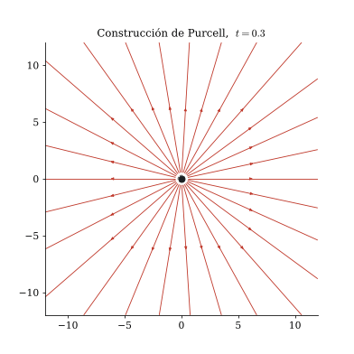
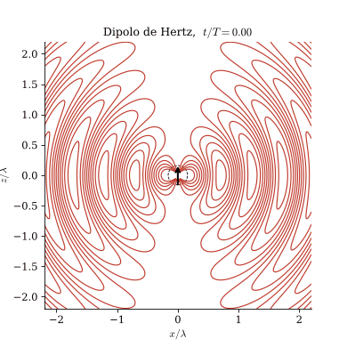
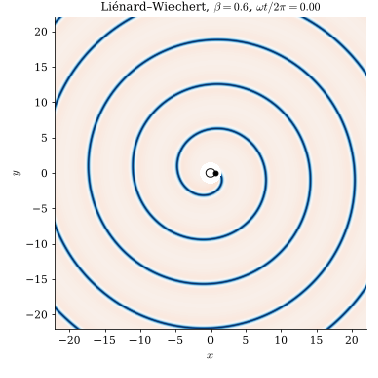

# Electromagnetismo Intermedio — Simulaciones

Colección de simulaciones en Python (Jupyter) que acompañan las guías de ejercicios del curso **Electromagnetismo Intermedio** (Instituto de Física y Astronomía, Universidad de Valparaíso, 2026).

Cada guía tiene su carpeta con cuadernos, figuras (PNG) y animaciones (GIF). La idea es pedagógica: verificar numéricamente los resultados que en la guía se obtienen a mano y usarlos para **ver** la física y la geometría que hay detrás.

<p align="center">
  
  
  
</p>

## Guías

| Guía | Carpeta | Temas | Cuadernos |
|---|---|---|---|
| 5 | [`Guia_05_Radiacion_Lienard_Wiechert/`](Guia_05_Radiacion_Lienard_Wiechert/) | Tiempo retardado, Liénard–Wiechert, Larmor, dipolos, sincrotrón, $\kappa^{-5}$ vs $\kappa^{-6}$ | 3 |
| 6 | [`Guia_06_Radiacion_Covarianza/`](Guia_06_Radiacion_Covarianza/) | Radiación, cuadrivectores, tensor $F_{\mu\nu}$, Maxwell covariante, acción, gauge, invariantes | 4 |

Cada carpeta tiene su propio `README.md`, con la tabla de problemas, las figuras y las verificaciones numéricas.

## Estructura

```
EI_Simulaciones/
├── README.md                  # este archivo
├── requirements.txt
├── em_utils.py                # módulo común: tensor F, boosts, Liénard–Wiechert, integración en la esfera, estilo
├── Guia_05_Radiacion_Lienard_Wiechert/
│   ├── 01_...ipynb, 02_...ipynb, 03_...ipynb
│   ├── figuras/
│   └── README.md
└── Guia_06_Radiacion_Covarianza/
    ├── 01_...ipynb ... 04_...ipynb
    ├── figuras/
    └── README.md
```

Para agregar una guía nueva: crear `Guia_NN_Tema/`, empezar cada cuaderno con

```python
import sys, os
sys.path.insert(0, os.path.abspath('..'))   # em_utils.py está en la raíz del repositorio
import em_utils as u
```

y guardar las figuras con `u.guardar(fig, 'PX_nombre')` / `u.guardar_gif(anim, 'PX_nombre')`. Quedan en `figuras/` junto al cuaderno.

## Instalación y ejecución

Requiere Python ≥ 3.10. En macOS conviene usar un entorno virtual (el Python del sistema es 3.9 y el de Homebrew no permite `pip install` global):

```bash
cd EI_Simulaciones
python3 -m venv .venv
source .venv/bin/activate
pip install -r requirements.txt
jupyter lab            # o abrir los .ipynb en VSCode y elegir el kernel ".venv"
```

Los cuadernos se ejecutan desde su propia carpeta (Jupyter y VSCode lo hacen por defecto).

## Convenciones

SI en el texto. En los cálculos se usan unidades adimensionales ($c=1$, $q/4\pi\varepsilon_0=1$, …), indicadas al inicio de cada cuaderno y en cada gráfico. En la parte relativista: $x^\mu=(ct,\mathbf x)$, $\eta_{\mu\nu}=\mathrm{diag}(1,-1,-1,-1)$, $A^\mu=(\phi/c,\mathbf A)$, $F_{\mu\nu}=\partial_\mu A_\nu-\partial_\nu A_\mu$.

## Referencias

- D. J. Griffiths, *Introduction to Electrodynamics*, 4.ª ed.
- J. D. Jackson, *Classical Electrodynamics*, 3.ª ed.
- L. D. Landau y E. M. Lifshitz, *The Classical Theory of Fields*.

## Autor

Carlos Felipe Pincheira Pincheira — Licenciatura en Física, mención Computación Científica, Universidad de Valparaíso.
Simulaciones desarrolladas con asistencia de Claude (Anthropic).
