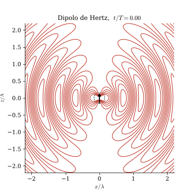
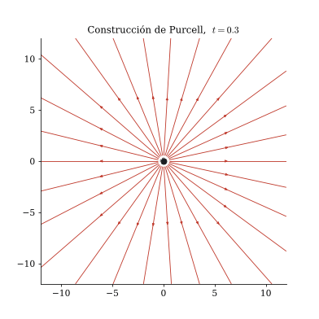
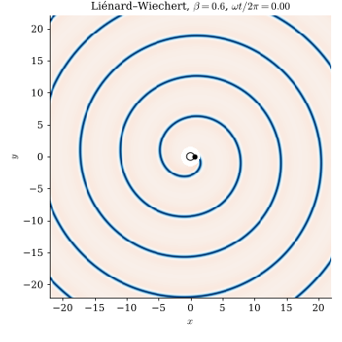
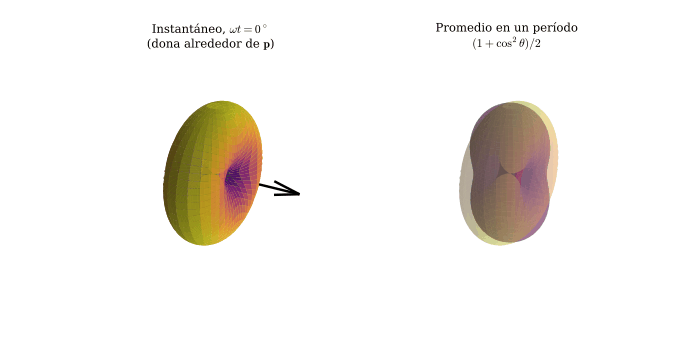
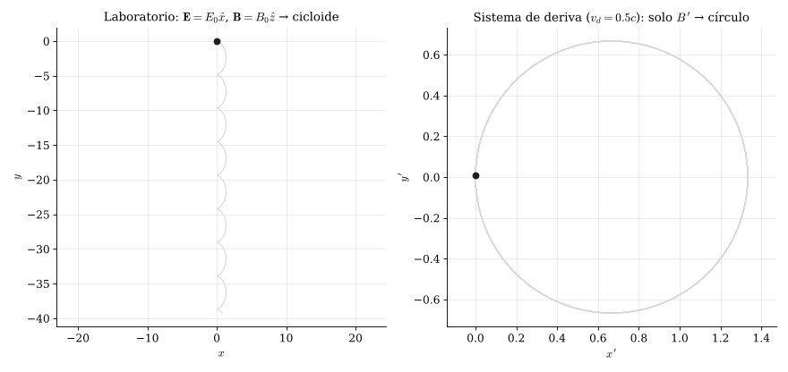
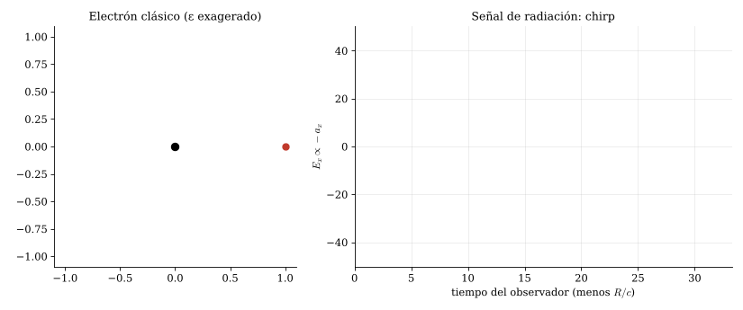

<h1 align="center">Electrodinámica — Electromagnetismo Intermedio</h1>

<p align="center">
  <em>Simulaciones, material de estudio y apuntes del curso de Electromagnetismo Intermedio (LFIS322)<br>
  Instituto de Física y Astronomía · Universidad de Valparaíso</em>
</p>

<p align="center">
  
  
  
  
</p>

---

Este repositorio reúne mi trabajo en **electrodinámica clásica** a lo largo del curso:

- **Simulaciones numéricas** en Python que acompañan cada guía de ejercicios. Verifican los resultados analíticos y muestran la física y la geometría que una derivación con lápiz y papel no deja ver.
- **Material de estudio** organizado por año: guías, ejercicios semanales, quizzes y pruebas.
- Un **[resumen del curso](RESUMEN_DEL_CURSO.md)**: el temario completo con las ecuaciones centrales de cada unidad comentadas.
- Un **formulario** de referencia.

La parte central es [`EI_Simulaciones/`](EI_Simulaciones/): 7 cuadernos de Jupyter, 40 figuras y 10 animaciones sobre radiación electromagnética, campos de Liénard–Wiechert, relatividad especial y la formulación covariante de la electrodinámica.

## Galería

<table>
  <tr>
    <td align="center" width="33%"><br><sub><b>Dipolo de Hertz.</b> Las líneas de E se cierran y se desprenden: así nace la radiación.</sub></td>
    <td align="center" width="33%"><br><sub><b>Construcción de Purcell.</b> Una carga recibe un empujón; el pliegue que viaja a velocidad c es el campo de radiación (Liénard–Wiechert exacto).</sub></td>
    <td align="center" width="33%"><br><sub><b>Carga en órbita circular (β = 0.6).</b> Espiral de radiación calculada resolviendo el tiempo retardado punto a punto.</sub></td>
  </tr>
  <tr>
    <td align="center"><br><sub><b>Dipolo rotante.</b> Patrón instantáneo que gira como un faro vs. patrón promedio (1 + cos²θ)/2.</sub></td>
    <td align="center"><br><sub><b>Deriva E×B.</b> La cicloide del laboratorio es un círculo en el sistema de deriva: la deriva <i>es</i> un boost de Lorentz.</sub></td>
    <td align="center"><br><sub><b>Colapso del átomo clásico.</b> El electrón radia, cae en espiral y emite un "chirp" (t ≈ 1.6×10⁻¹¹ s).</sub></td>
  </tr>
</table>

## Contenido del repositorio

```
Electrodynamics/
├── EI_Simulaciones/                       ← simulaciones (Jupyter + Python)
│   ├── em_utils.py                        ← módulo común (tensor F, boosts, Liénard–Wiechert, …)
│   ├── requirements.txt
│   ├── Guia_05_Radiacion_Lienard_Wiechert/   3 cuadernos · 19 figuras
│   └── Guia_06_Radiacion_Covarianza/         4 cuadernos · 31 figuras
├── RESUMEN_DEL_CURSO.md                   ← temario y formulario comentado del curso
├── Material electro, guías, pruebas/      ← material del curso por año
│   ├── Electro 2024/
│   ├── Electro 2025/
│   └── Electro 2026/
└── formulario electro.pdf                 ← formulario de referencia
```

### 1. Simulaciones — [`EI_Simulaciones/`](EI_Simulaciones/)

Cada guía tiene su carpeta con cuadernos ejecutados, figuras y un README propio con la tabla de problemas y las verificaciones numéricas.

#### Guía 5 — Radiación: Liénard–Wiechert, Larmor y radiación relativista · [ver carpeta](EI_Simulaciones/Guia_05_Radiacion_Lienard_Wiechert/)

| Cuaderno | Problemas | Lo que se simula |
|---|---|---|
| [`01_tiempo_retardado_lienard_wiechert`](EI_Simulaciones/Guia_05_Radiacion_Lienard_Wiechert/01_tiempo_retardado_lienard_wiechert.ipynb) | 1–3 | Diagrama espacio-tiempo del retardo ($dt/dt_r=\kappa$); $E_{\rm vel}\propto R^{-2}$ vs. $E_{\rm rad}\propto R^{-1}$; flujo de Poynting por esferas (solo la parte radiativa escapa); construcción de Purcell; $\mathbf E$, $\mathbf B$ y $\mathbf S$ sobre la esfera |
| [`02_larmor_dipolos`](EI_Simulaciones/Guia_05_Radiacion_Lienard_Wiechert/02_larmor_dipolos.ipynb) | 4–9 | "Fotones" Monte Carlo muestreados de $\sin^2\theta$; fracción ecuatorial $11/16$; espectro de un pulso de aceleración; dipolo rotante; amortiguamiento radiativo, ancho de línea clásico y vidas medias atómicas |
| [`03_radiacion_relativista`](EI_Simulaciones/Guia_05_Radiacion_Lienard_Wiechert/03_radiacion_relativista.ipynb) | 10–14 | Colapso del átomo clásico; enfriamiento sincrotrón con reacción de radiación; pulsos y armónicos hasta $n\sim\gamma^3$; asimetría adelante/atrás; $\kappa^{-6}$ (detector) vs. $\kappa^{-5}$ (fuente) |

#### Guía 6 — Radiación y covarianza de la electrodinámica · [ver carpeta](EI_Simulaciones/Guia_06_Radiacion_Covarianza/)

| Cuaderno | Problemas | Lo que se simula |
|---|---|---|
| [`01_radiacion`](EI_Simulaciones/Guia_06_Radiacion_Covarianza/01_radiacion.ipynb) | 1–4 | Órbita elíptica y polarización en todas las direcciones; patrón dipolar oblicuo; dipolo de Hertz con campos completos y ley $\omega^4$; efecto faro y factores $\gamma^6$, $\gamma^4$ |
| [`02_cuadrivectores_tensor`](EI_Simulaciones/Guia_06_Radiacion_Covarianza/02_cuadrivectores_tensor.ipynb) | 5–8 | Cuadricorriente en el espacio-tiempo; $F_{\mu\nu}$ vs. $F^{\mu\nu}$; campo de una carga en movimiento obtenido boosteando Coulomb; integración de $dU^\mu/d\tau=(q/m)F^{\mu\nu}U_\nu$ |
| [`03_maxwell_accion_gauge`](EI_Simulaciones/Guia_06_Radiacion_Covarianza/03_maxwell_accion_gauge.ipynb) | 9–14 | Maxwell y Bianchi con SymPy; Euler–Lagrange automático; **integrador variacional** (la ecuación de onda sale de una acción discreta); gauge y conservación de carga; Liénard–Wiechert y gauge de Lorenz |
| [`04_onda_plana_invariantes`](EI_Simulaciones/Guia_06_Radiacion_Covarianza/04_onda_plana_invariantes.ipynb) | 15 | Onda plana 3D; Doppler y aberración; $T^{\mu\nu}\propto k^\mu k^\nu$; **plano de invariantes** de Lorentz bajo cientos de boosts aleatorios |

#### Filosofía de las simulaciones

1. **Verificar antes de visualizar.** Cada resultado analítico de la guía se comprueba numéricamente: integrales sobre la esfera, solución numérica del tiempo retardado, EDOs, álgebra simbólica. El cuaderno imprime la comparación.
2. **Ir más allá del enunciado.** Por ejemplo: la polarización en *todas* las direcciones y no solo en el eje, el espectro de un pulso, el campo completo del dipolo y no solo el lejano, o la reacción de radiación en el sincrotrón.
3. **Conectar con la física actual.** El cielo azul (Rayleigh), los pulsares (dipolo rotante), las vidas medias atómicas, la radiación sincrotrón en aceleradores, el *chirp* de ondas gravitacionales y el fotón como flujo sin masa ($T^{\mu\nu}\propto k^\mu k^\nu$).

#### Algunas verificaciones

| Resultado | Numérico |
|---|---|
| Potencia relativista $P_\parallel/P_\perp=\gamma^2$ ($=25/16$ para $\beta=3/5$) | integración de la fórmula de Liénard sobre la esfera, error $<10^{-12}$ |
| Flujo radiativo por esferas de radio $0.3$ a $300\,c/\omega$ | $=P_{\rm Larmor}$ a todo radio (diferencia $\mathcal O(\beta^2)$) |
| Colapso del átomo clásico $t=a_0^3/4r_e^2c$ | $1.5562\times10^{-11}$ s |
| Coulomb boosteado = campo de Heaviside de una carga en movimiento | error relativo $\sim10^{-15}$ |
| Deriva $\mathbf E\times\mathbf B$: $v_d=E/B$ (exacta, también relativista) | 5 cifras |
| $\partial_\mu F^{\mu\nu}=\mu_0J^\nu$ ⇔ Gauss + Ampère–Maxwell | SymPy: diferencia idénticamente nula |
| Energía en reloj del detector = energía en reloj de la fuente | razón $=1$ para todo $\beta$ |

### 2. Material del curso — [`Material electro, guías, pruebas/`](Material%20electro%2C%20gu%C3%ADas%2C%20pruebas/)

| Año | Contenido |
|---|---|
| **2024** | Ejercicios semanales (semanas 1–5), apuntes clase a clase, pruebas de años anteriores y soluciones |
| **2025** | Apuntes clase a clase, hojas de trabajo, quizzes 1–5 (algunos con solución), primera y tercera prueba |
| **2026** | Guías de ejercicios (2, 4, 5 y 6), funciones de Green, notación indicial y coordenadas curvilíneas, guía de preparación del Quiz 5 (con fuente `.tex`), Quiz 3 |

El material de guías y evaluaciones fue elaborado por el equipo docente del curso.

### 3. Formulario — [`formulario electro.pdf`](formulario%20electro.pdf)

Resumen de fórmulas de referencia para el curso.

## Temario y resumen del curso

📘 **[RESUMEN_DEL_CURSO.md](RESUMEN_DEL_CURSO.md)**: formulario comentado de todo el curso, con las ecuaciones centrales de cada unidad, de dónde salen, cuándo valen y qué significan, y enlaces a las simulaciones correspondientes.

| # | Unidad | Ideas y ecuaciones clave |
|---|---|---|
| 1 | [Herramientas matemáticas](RESUMEN_DEL_CURSO.md#s1) | Notación indicial, $\epsilon_{ijk}\epsilon_{imn}$, teoremas de Gauss y Stokes, delta de Dirac, $\nabla^2(1/r)=-4\pi\delta^3$, coordenadas curvilíneas |
| 2 | [Electrostática](RESUMEN_DEL_CURSO.md#s2) | Coulomb, $\nabla\cdot\mathbf E=\rho/\varepsilon_0$, $\nabla\times\mathbf E=0$, Poisson y Laplace, condiciones de borde, conductores |
| 3 | [Energía y capacidad](RESUMEN_DEL_CURSO.md#s3) | $W=\frac{\varepsilon_0}{2}\int E^2$, autoenergía, presión electrostática, desplazamiento virtual |
| 4 | [Problemas de contorno](RESUMEN_DEL_CURSO.md#s4) | Unicidad, funciones de Green (Dirichlet y Neumann), valor medio, imágenes, separación de variables, Legendre |
| 5 | [Expansión multipolar](RESUMEN_DEL_CURSO.md#s5) | Monopolo, dipolo y cuadrupolo; dipolo en campo externo |
| 6 | [Magnetostática](RESUMEN_DEL_CURSO.md#s6) | Biot–Savart, $\nabla\cdot\mathbf B=0$, Ampère, potencial vector, gauge de Coulomb, dipolo magnético |
| 7 | [Campos en la materia](RESUMEN_DEL_CURSO.md#s7) | $\mathbf P$, $\mathbf D$, cargas ligadas; $\mathbf M$, $\mathbf H$, corrientes ligadas; dia-, para- y ferromagnetismo |
| 8 | [Inducción y Maxwell](RESUMEN_DEL_CURSO.md#s8) | Faraday (circuitos fijos y móviles), corriente de desplazamiento, ecuaciones de Maxwell, ondas |
| 9 | [Leyes de conservación](RESUMEN_DEL_CURSO.md#s9) | Teorema de Poynting, tensor de esfuerzos de Maxwell, momento y momento angular del campo |
| 10 | [Potenciales y gauge](RESUMEN_DEL_CURSO.md#s10) | Transformaciones de gauge, gauges de Coulomb y Lorenz, $\Box A^\mu=\mu_0J^\mu$, potenciales retardados |
| 11 | [Liénard–Wiechert](RESUMEN_DEL_CURSO.md#s11) | Tiempo retardado, $\kappa=1-\hat{\mathbf n}\cdot\boldsymbol\beta$, campos de velocidad y de radiación, carga uniforme |
| 12 | [Radiación](RESUMEN_DEL_CURSO.md#s12) | Larmor, dipolo eléctrico y magnético, fuente arbitraria, Liénard y efecto faro, reacción de radiación |
| 13 | [Relatividad y covarianza](RESUMEN_DEL_CURSO.md#s13) | Cuadrivectores, $F_{\mu\nu}$, transformación de campos, invariantes, Maxwell covariante, acción, $T^{\mu\nu}$ |


## Convenciones

Unidades SI en el texto. En los cálculos se usan unidades adimensionales ($c=1$, $q/4\pi\varepsilon_0=1$, …), indicadas en cada cuaderno y en cada gráfico. Para la parte relativista:

$$x^\mu=(ct,\mathbf x),\qquad \eta_{\mu\nu}=\mathrm{diag}(1,-1,-1,-1),\qquad A^\mu=(\phi/c,\mathbf A),\qquad F_{\mu\nu}=\partial_\mu A_\nu-\partial_\nu A_\mu .$$

## Próximamente

- [ ] Simulaciones de guías anteriores (Guía 4, funciones de Green)
- [ ] Simulaciones de las próximas guías del curso
- [ ] Integración de las animaciones en la plataforma *Academia Científica*

## Referencias

- D. J. Griffiths, *Introduction to Electrodynamics*, 4.ª ed., Cambridge University Press.
- J. D. Jackson, *Classical Electrodynamics*, 3.ª ed., Wiley.
- L. D. Landau y E. M. Lifshitz, *The Classical Theory of Fields*, Butterworth-Heinemann.
- E. M. Purcell y D. J. Morin, *Electricity and Magnetism*, 3.ª ed. (construcción de las líneas de campo de radiación).


Simulaciones desarrolladas con asistencia de Claude (Anthropic).